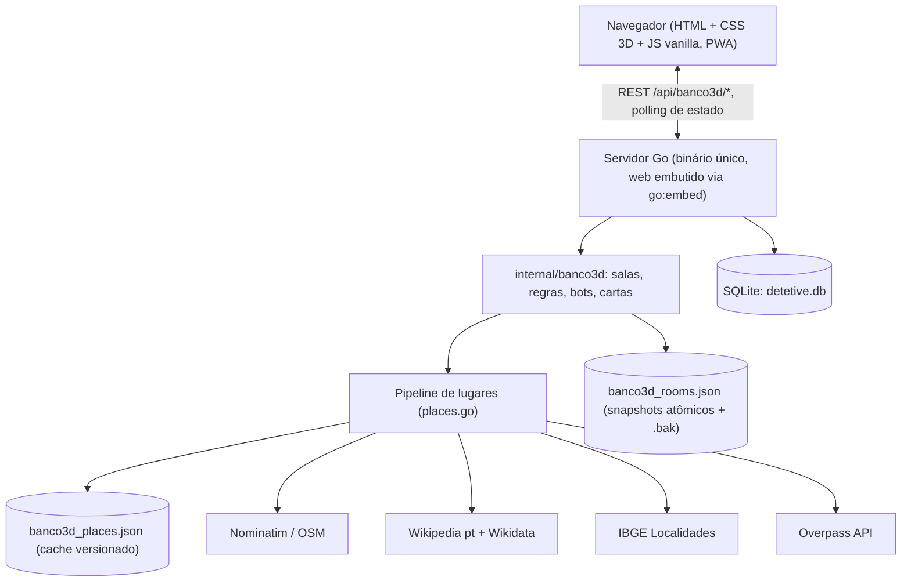

<div align="center">

# 🎲 Tabuleiro IA

**Hub de jogos de tabuleiro online em Go: Detetive IA (jogo investigativo) e Banco Imobiliário 3D "Império Urbano" (multiplayer, com bots e lugares reais da sua cidade).**

[](https://go.dev)
[](https://www.sqlite.org)
[](https://developer.mozilla.org/docs/Web/CSS/transform-function/rotate3d)
[](https://web.dev/progressive-web-apps/)
[](https://www.docker.com)
[](https://casaos.io)

<p align="center">
  Um único binário Go com todo o front embutido, tema escuro com <strong>glassmorphism</strong>, <strong>3D em CSS puro</strong>, partidas com <strong>amigos e bots</strong> e um tabuleiro gerado a partir de <strong>lugares reais</strong> do município que você escolher.
</p>

</div>

---

## 🌟 Destaques & Funcionalidades

### 🏙️ Banco Imobiliário 3D: Império Urbano
* **Tabuleiro da sua cidade**: digite uma cidade ou região (autocomplete com UF, ex.: *Magé, RJ*) e a API busca pontos conhecidos **reais** daquele município. Nada é inventado; cidade sem dados suficientes devolve erro claro (503), não nomes falsos.
* **Votação do ícone (15s)**: os jogadores votam no lugar mais icônico; o vencedor vira a casa mais cara (casa 39). Os demais lugares preenchem o tabuleiro **do mais barato ao mais caro**, no estilo *Business Tour*.
* **Layout Business Tour** (inspirado no app da Steam 397900):
  * Cantos: **0 Início** (embaixo à direita), **10 Viagem / World Tour** (embaixo à esquerda), **20 Ilha Perdida** (prisão, em cima à esquerda) e **30 Chance / Imposto Especial** (em cima à direita).
  * 22 propriedades em curva de preço R$ 60 → R$ 400, 4 estações (5, 15, 25, 35), 2 serviços (12, 28) e 2 impostos (4, 38).
* **Sorte e Revés unificados**: um único baralho temático, com imagem própria por carta (terremoto, enchente, incêndio, apagão, greve, loteria, herança, festival, fiscalização, crise, prisão). A carta aparece animada para **todos** os jogadores, inclusive nas jogadas dos bots, e pode ser dispensada.
* **Eventos que mudam o jogo**: terremoto destrói casa/hotel; propriedade pode voltar ao banco (10%); **Festival ×2** (1 rodada) e **Campeonato ×3** no aluguel.
* **Casas e hotéis**: construção por turno, só com monopólio, de forma uniforme; hotel no nível 5.
* **Regras de fluxo**: salário de R$ 200 ao passar pelo Início, dados duplos jogam de novo (3 duplas = prisão), fiança de R$ 50, compra passa a vez automaticamente (janela de decisão de 12s) e inatividade de 30s pula o jogador.
* **Duração da partida**: sem limite ou 15 / 30 / 60 / 90 minutos. Ao fim do relógio, vence quem tiver o **maior patrimônio** (dinheiro + propriedades + construções; empate decidido pelo dinheiro).
* **Trocas entre jogadores**: propostas com resposta (aceita / recusada / pendente) e motivo. Os **bots avaliam a troca** e recusam as ruins (margem de 10 a 20%).
* **Bots em 3 níveis** (fácil, normal, difícil): reserva de caixa de R$ 100 / 250 / 400 e compra agressiva para fechar grupos de cor no difícil.
* **Multiplayer**: salas por código, vários humanos na mesma partida, reconexão com F5, menu de opções com **Sair**, e salas que sobrevivem a reinício do servidor.

### 🎨 Interface & Animações
* **Tema escuro com glassmorphism**, hover em todos os botões e **transições suaves** entre telas (View Transitions API).
* **Dados 3D** que são lançados e pousam espalhados, perspectiva do tabuleiro, peões 3D centralizados e animação ao atravessar casas.
* **Dinheiro animado** (contadores com tween) e painel lateral "**Minhas propriedades**" em miniquadrados, com hover e clique.
* **Imagens ricas** por propriedade, casas laterais legíveis e sem corte, tela final com ranking.

### 🕵️ Detetive IA
* Jogo investigativo web/PWA (manifest + service worker), com login simples e painel admin.
* Projetado para rodar em VPS de **1 GB de RAM**.

---

## 🏛️ Arquitetura do Sistema



### Pipeline de lugares reais
1. **Resolução da cidade**: o autocomplete devolve um `place_id`, que é enviado na criação da sala e tem prioridade sobre o texto digitado. Há casamento **exato** (sem acento e sem UF) com o catálogo de presets, então uma cidade nunca herda lugares de outra.
2. **Fontes em paralelo**: Nominatim (1 req/s, backoff em 429/403), Wikipedia pt (geosearch e categorias), Wikidata (SPARQL), IBGE (distritos) e Overpass (espelhos concorrentes), com busca estruturada de ruas para cidades pequenas.
3. **Filtro de qualidade** de nomes, cache em disco versionado e flag `partial` quando a lista é incompleta.
4. Sem dados suficientes: **HTTP 503 com `Retry-After`**. Nunca nomes inventados.

---

## 🛠️ Stack Tecnológica

| Camada | Tecnologia | Descrição |
|---|---|---|
| **Backend** | Go 1.26 (monólito) | Servidor HTTP único, sem dependências de runtime |
| **Frontend** | HTML, CSS 3D, JavaScript vanilla | Embutido no binário (`go:embed`) e servido em `/banco/` |
| **Banco de dados** | SQLite (`detetive.db`) | Usuários, admin e dados do Detetive IA |
| **Estado do Banco 3D** | JSON em disco | Snapshots atômicos com `.bak`, autosave a cada 30s e gravação no shutdown |
| **Dados de lugares** | Nominatim, Wikipedia, Wikidata, IBGE, Overpass | Lugares reais do município, com cache versionado |
| **Containerização** | Docker multi-stage, Compose | Imagem alpine não-root, volume nomeado, healthcheck |

---

## 🚀 Como Executar

### Opção 1: Docker (recomendado, também no CasaOS / Ubuntu)

```bash
git clone https://github.com/LimaEdu-7x/tabuleiro-ia.git
cd tabuleiro-ia
cp .env.example .env        # defina ADMIN_PASSWORD
docker compose up -d --build
docker compose ps           # aguarde o estado "healthy"
```

* **Hub**: `http://localhost:8080/`
* **Banco Imobiliário 3D**: `http://localhost:8080/banco/`
* **No servidor**: troque `localhost` pelo IP do CasaOS/Ubuntu. Para mudar a porta do host, use `HOST_PORT` no `.env`.

Detalhes de volume, backup e logs em [`docs/DOCKER.md`](docs/DOCKER.md).

### Opção 2: Go local

```bash
go run ./cmd/server
```

Pré-requisito: Go 1.26 ou superior. Por padrão o servidor usa a porta `8080` e a pasta `data/`.

### Variáveis de ambiente

| Variável | Padrão | Descrição |
|---|---|---|
| `PORT` | `8080` | Porta do servidor dentro do container |
| `HOST_PORT` | `8080` | Porta publicada no host (Compose) |
| `DB_PATH` | `/app/data/detetive.db` | Arquivo SQLite |
| `BANCO3D_CACHE_FILE` | `/app/data/banco3d_places.json` | Cache de lugares reais |
| `ADMIN_USER` | `admin` | Usuário administrador |
| `ADMIN_PASSWORD` | *(vazio)* | Se vazio, uma senha aleatória é gerada no 1º boot em `/app/data/admin_password.txt` (0600) |

Ler a senha gerada:
```bash
docker compose exec detetive cat /app/data/admin_password.txt
```

### Persistência e backup
Os dados ficam no volume nomeado `detetive-data` (`/app/data`): `detetive.db`, `banco3d_rooms.json` e `banco3d_places.json`. Atualizar a imagem com `docker compose up -d --build` **mantém** as salas.
```bash
docker run --rm -v detetive-data:/d -v "$PWD":/b alpine tar czf /b/data.tgz -C /d .
```
> ⚠️ Nunca use `docker compose down -v` sem querer apagar os dados: o `-v` remove o volume.

---

## 📋 Principais Endpoints da API (Banco 3D)

Prefixo: `/api/banco3d`

* `GET /places/suggest?q=...` — autocomplete de cidades (devolve `id`, nome e UF).
* `GET /places/landmarks?place_id=...` — lugares reais do município (`partial`, `candidates`, `landmarks`).
* `POST /room/create` — cria a sala (`room_id`, `city`, `place_id`, `config`).
* `POST /room/join` — entra na sala; reconexão por `player_id`.
* `POST /room/vote` — vota no lugar mais icônico (15s).
* `GET /city` — resolve uma cidade e devolve o preset de tabuleiro.
* `POST /room/start` — inicia a partida (após a votação do ícone).
* `GET /room/state` — estado completo (tabuleiro, jogadores, eventos, relógio, ranking).
* `POST /room/roll` — rola os dados.
* `POST /room/buy` / `POST /room/pass` — compra ou recusa a propriedade.
* `POST /room/build` — constrói casa ou hotel.
* `POST /room/trade` — propõe e responde trocas.
* `POST /room/leave` — sai da partida.

---

## 🧪 Testes

```bash
go vet ./...
go test ./...
go test -race ./internal/...   # requer gcc (CGO); no Windows rode dentro do Docker
```

A suíte cobre regras (dados duplos, prisão, cartas, construção), bots, votação, persistência após reinício, pipeline de lugares (com HTTP simulado, sem rede) e um teste multiplayer de API com 3 jogadores humanos.

---

## 📁 Estrutura do Projeto

```text
cmd/server/            ponto de entrada
internal/banco3d/      regras, tabuleiro, cartas, bots, salas, hub e lugares reais
internal/server/       handlers HTTP e testes de API
internal/{auth,db,game,room,telemetry}/   módulos do Detetive IA e infraestrutura
web/                   front embutido: Detetive IA (static, templates) e Banco 3D (banco3d/)
docs/                  CHANGELOG, DOCKER e pesquisas de design
tests/                 integração e caos
Dockerfile · docker-compose.yml · .env.example
```

---

## 🗺️ Versões

O módulo Banco Imobiliário usa tags `banco-vX.Y.Z`. O histórico completo está em [`docs/CHANGELOG.md`](docs/CHANGELOG.md). Versão atual: **banco-v1.5.0** (Docker, multiplayer validado, lugares reais corrigidos).

---

## ⚠️ Limitações Conhecidas

* Cidades muito pequenas podem ter nomes de lugar pouco expressivos (ex.: ruas numeradas), pois dependem da cobertura do OpenStreetMap.
* O Nominatim limita a 1 requisição por segundo; a primeira busca de uma cidade nova pode demorar, e as seguintes saem do cache.
* Se a cidade for digitada sem escolher uma opção da lista, não há `place_id` e o tabuleiro cai em nomes procedurais.

---

## 📄 Licença

Projeto privado. Todos os direitos reservados.
