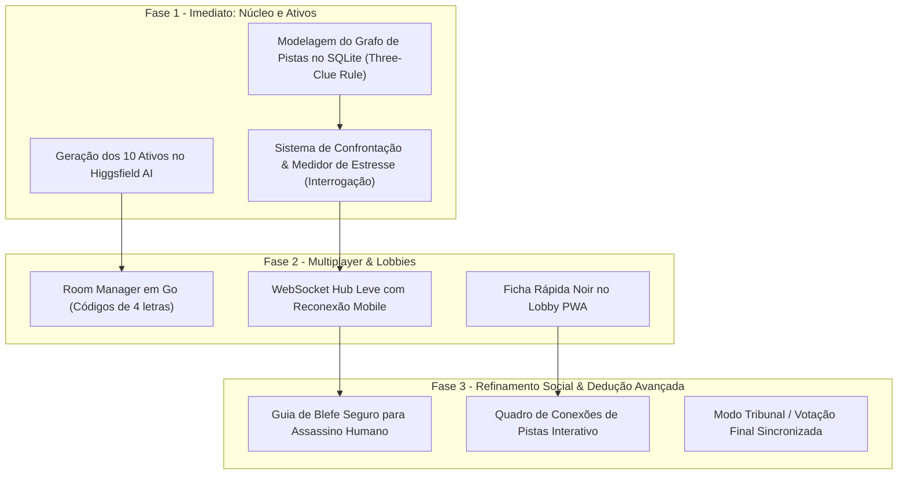

# Relatório de Pesquisa & Game Design: Detetive IA
**Autor:** Oracle (Game Researcher & Ideator)  
**Data:** 14 de Outubro de 2026  
**Projeto:** Detetive IA — Monolito Go + SQLite + PWA Noir  

---

## 1. Resumo Executivo & Visão do Momento "Eureka"

O objetivo central desta pesquisa é transformar o **Detetive IA** de um jogo investigativo linear em uma **plataforma procedural viva de dedução social e mistério noir**. 

Para atingir a sensação **"Eureka!"** desejada:
1. **Entrada do Jogador no Mundo:** O jogador e seus amigos definem suas personas no lobby (profissões, vícios, segredos).
2. **Geração Inversa (Backwards Mystery Generation):** O motor do jogo não sorteia fatos ao acaso; ele parte da solução e tece um Grafo de Dependência de Informações (**IDG - Information Dependency Graph**), ancorado na regra das três pistas (**Three-Clue Rule**).
3. **Isolamento entre Fato e Retórica:** O banco de dados (SQLite) é a única fonte da verdade imutável. A LLM nunca decide fatos ou culpados; ela apenas atua como intérprete teatral do nó de conhecimento do suspeito, eliminando alucinações lógicas.
4. **Interrogatório com Pressão (Stress & Confrontation):** O culpado nunca confessa de graça. Suspeitos possuem medidores de estresse e só quebram quando confrontados com contradições materiais e testemunhais.
5. **Máxima Eficiência de Ativos Audiovisuais:** Uso cirúrgico dos 10 tokens na plataforma Higgsfield AI para gerar ativos de fundação (arquétipos, micro-animações de reação, cenários e objetos de crime).

---

## 2. Referências Analisadas na Indústria & Fóruns de Jogos

### 2.1. *Return of the Obra Dinn* & *The Case of the Golden Idol*
* **Mecânica Chave:** Matriz de Dedução Lógica sem spoon-feeding.
* **Aprendizado:** O jogo não deve validar teorias linha por linha, para evitar que o jogador descubra por tentativa e erro (brute force). O veredito deve exigir a tríade completa (**Suspeito + Arma + Motivo**) ou confirmações em blocos de conclusões.

### 2.2. *Shadows of Doubt* & *Dwarf Fortress* (Proc-Gen de Crimes)
* **Mecânica Chave:** Geração de crimes a partir de simulação e grafos de dependência.
* **Aprendizado:** A criação de mistérios procedurais falha quando é "forward-random" (sortear dados para frente gera becos sem saída ou soluções impossíveis). A técnica recomendada por desenvolvedores no *r/gamedev* é **Reverse-Planning / Goal-Driven Generation** (gerar a partir do assassinato e construir as evidências para trás).

### 2.3. Justin Alexander's *Three-Clue Rule* (Tabletop & Interactive Mystery Design)
* **Regra de Ouro:** Para qualquer conclusão necessária à resolução do caso, deve haver **pelo menos 3 pistas independentes** (1 física/forense, 1 testemunhal, 1 documental/circunstancial).
* **Adaptação para o Detetive IA:** Validação algorítmica em Go. Ao gerar o caso, um algoritmo de busca em grafo (BFS/DFS) garante que o nó da solução tenha $\ge 3$ caminhos independentes acessíveis.

### 2.4. *Blood on the Clocktower* & *Town of Salem*
* **Mecânica Chave:** Conflito de alegações (Counter-Claims) e "Safe Bluffs".
* **Aprendizado:** Inocentes também devem ter segredos embaraçosos ou pequenos delitos não relacionados ao assassinato (Red Herrings legítimos). Isso impede que o jogador deduza que "ficou nervoso / mentiu = é o assassino".
* **Para o Assassino Humano:** O jogo deve fornecer um "Guia de Blefe Seguro" com 2 ou 3 álibis não ocupados por ninguém na trama, para que o jogador traidor possa mentir de forma verossímil.

### 2.5. *Jackbox Games* (*Push The Button*, *Trivia Murder Party*) & *Among Us*
* **Mecânica Chave:** Acessibilidade instantânea via smartphone (controle no bolso, tela na TV ou PC).
* **Aprendizado:** Código de sala curto (4 a 5 letras legíveis), sem fricção de download ou cadastro complexo para convidados. Sincronização de estado leve e resiliente a quedas de rede mobile.

---

## 3. Tópicos do Briefing: Propostas de Mecânicas, Prós, Contras e Viabilidade

---

### TÓPICO 1: Geração Procedural de Mistérios (Graph-Based Deduction)

#### A Mecânica Proposta: *The Inverse Crime Graph Engine*
1. **Entrada:** Perfis dos jogadores (nome, ocupação, segredo, hábito) + preenchimento de bots com arquétipos clássicos noir.
2. **Sorteio do Núcleo da Verdade:**
   - Vítima selecionada (pode ser um NPC proeminente, ex: Magnata da cidade, Juiz corrompido).
   - Assassino escolhido (humano ou bot).
   - Arma do Crime e Causa Mortis.
   - Motivo (Vingança, Chantagem, Ganância, Paixão).
3. **Construção do Grafo de Pistas (Three-Clue Rule Validation):**
   - **Pista Física:** Ex: Fio de tecido da capa do assassino encontrado na janela; resíduo de pólvora ou veneno.
   - **Pista Testemunhal (Contradição de Álibi):** O assassino afirma que estava no Hotel às 22h, mas a camareira ou outro jogador atesta que as luzes do quarto estavam apagadas e ouviu passos no beco.
   - **Pista Documental:** Registro de penhor, bilhete ameaçador com caligrafia coincidente, extrato bancário com saque recente.
4. **Isolamento de Conhecimento por Personagem (Graph-RAG):**
   - Cada suspeito só tem acesso a um subconjunto estrito do grafo.
   - A LLM é instruída a assumir a persona e responder estritamente com os fatos que conhece. Se questionada sobre algo que não sabe, deve agir com desdém, ignorância ou suspeita natural.

* **Prós:**
  - Zero alucinação nos fatos do crime: o backend valida a lógica antes da LLM ser chamada.
  - Replayability infinita: cada partida gera um grafo e uma rede de relações única.
  - Imune a quebras de jogo: o verificador matemático do grafo garante que o caso sempre tem solução.
* **Contras:**
  - Exige modelagem cuidadosa das tabelas de grafo no SQLite.
* **Viabilidade Técnica em Go + SQLite:** **Altíssima (10/10)**. Tabelas simples (`nodes`, `edges`, `suspect_knowledge`) e algoritmo de validação DFS em Go puro (< 200 linhas, execução em < 2ms, zero alocação de memória relevante).

---

### TÓPICO 2: Lobbies, Códigos de Sala e Sincronização

#### A Mecânica Proposta: *Jackbox-Style Noir Lobby & Room Manager*
1. **Geração de Códigos Amigáveis:**
   - Códigos de 4 letras maiúsculas gerados a partir de um alfabeto sem caracteres ambíguos (exclui `I, 1, O, 0, Z, 2`). Ex: `NOIR`, `FOGS`, `JADE`, `MIST`.
2. **Fluxo de Entrada e Ficha Rápida Noir:**
   - O jogador acessa `site/sala` ou digita o código.
   - Preenche em 30 segundos (ou clica no botão "Dado da Sorte / Gerar Ficha"):
     - *Nome / Codinome*
     - *Profissão no Submundo* (ex: contrabandista de uísque, cantora de jazz)
     - *Segredo Oculto* (ex: dívida impagável com o agiota)
3. **Tecnologia de Sincronização em Tempo Real:**
   - **Arquitetura Escolhida:** **WebSockets leves com fallback SSE**.
   - Em Go, o pacote nativo ou bibliotecas minimalistas (`nhooyr.io/websocket` ou `gorilla/websocket`) consomem ~4KB por conexão ativa.
   - Para uma sala de 4 a 8 jogadores, o overhead de rede e RAM é inferior a 50KB!
   - **Mecanismo de Resiliência Mobile:** Token de sessão em `sessionStorage`. Se o jogador trocar de app ou a tela apagar no celular, ao reabrir o navegador ele se reconecta automaticamente ao mesmo slot sem perder o progresso.

* **Prós:**
  - Experiência social fluida idêntica ao Jackbox / Among Us.
  - Todo o processamento fica no servidor Go sem sobrecarregar o cliente PWA.
* **Contras:**
  - Requer gerenciar ciclo de vida de desconexões com timer de tolerância (grace period de 30s).
* **Viabilidade Técnica em Go + SQLite:** **Altíssima (10/10)**. O modelo de concorrência com goroutines e canais em Go foi feito sob medida para isso.

---

### TÓPICO 3: Estratégia de Alto Impacto para os 10 Tokens do Higgsfield AI

Com **10 tokens disponíveis**, a prioridade é gerar ativos fundacionais permanentes e reutilizáveis, e não queimar tokens em casos temporários descartáveis.

#### Distribuição Recomendada dos 10 Tokens:

| Qtd | Tipo de Ativo | Descrição / Papel no Jogo | Efeito no Jogador |
| :---: | :--- | :--- | :--- |
| **4 Tokens** | **Retratos Mestres de Arquétipos Noir (Imagens Hi-Res)** | 1. *A Femme Fatale Enigmática* 2. *O Magnata Industrial Corrupto* 3. *O Mordomo / Fixer Silencioso* 4. *O Detetive / Jornalista Cínico* | Personagens visualmente marcantes que o jogo pode associar aos suspeitos de cada partida. |
| **2 Tokens** | **Micro-Vídeos de Reação / Animação de Fala (Genjutsu Motion)** | 1. *Reação de Estresse / Quebra de Álibi*: Suspeito engole em seco, olhar esquivo, traga cigarro com a mão trêmula. 2. *Reação de Arrogância / Blefe*: Sorriso de escárnio, sobrancelha arqueada desdenhando da acusação. | Traz vida cinematográfica à sala de interrogatório quando uma contradição é exposta. |
| **2 Tokens** | **Cenas de Crime Noir (Cenários Atmosféricos)** | 1. *O Beco Encharcado de Chuva*: Reflexo de néon âmbar nas poças d'água, vapor saindo de bueiros. 2. *O Gabinete Fechado da Mansão*: Persiana veneziana projetando faixas de sombra dramáticas na mesa ensanguentada. | Ambientação imersiva na tela de busca por pistas e dossiê. |
| **2 Tokens** | **Evidências Forenses / Armas do Crime (Close Macro)** | 1. *Frasco de Veneno Prateado & Luvas de Pelica* em cima de um jornal de época. 2. *Revólver Colt .38 com empunhadura de madrepérola* repousando sobre papéis queimados. | Visual palpável dos nós de pistas no Quadro de Deduções. |

#### Engenharia de Prompt para o Higgsfield AI:
* **Style Negative Prompt:** `modern, bright vibrant colors, anime, cartoon, 3d render, plastic skin, daylight, saturation, flat lighting`
* **Master Noir Prompt Template:**
  > `"1940s vintage film noir, dramatic chiaroscuro lighting, deep black shadows, soft amber warm practical light, heavy venetian blind shadows, 35mm film grain, cinematic anamorphic lens, highly detailed, gritty realism, cinematic atmospheric haze, award-winning photography"`
* **Prompt para Reação de Estresse (Vídeo Genjutsu):**
  > `"Medium close-up portrait of 1940s film noir suspect, eyes shifting nervously, swallowing hard, cigarette smoke drifting past face, chiaroscuro lighting, subtle facial twitch of guilt, cinematic noir, 24fps smooth loop"`

* **Prós:**
  - Extrai 100% de valor visual do lote de 10 tokens.
  - Ativos tornam-se parte do pacote estático embutido no binário (`embed.FS`).
* **Contras:**
  - Requer execução cuidadosa dos prompts no portal para não desperdiçar nenhum token.
* **Viabilidade Técnica:** **Perfeita (10/10)**. O portal Maestri com Higgsfield já está aberto e pronto.

---

### TÓPICO 4: Dinâmica de Interrogatório Social & Sistema de Blefe

#### A Mecânica Proposta: *Stress Meter & Evidence Confrontation Loop*
1. **Medidor de Estresse do Suspeito (0 a 100%):**
   - No início, o suspeito está calmo (Estresse: 0-20%).
   - Se o jogador faz perguntas vagas ("Você estava lá?"), o suspeito responde com desdém e o estresse não sobe.
2. **Mecânica de Confrontação de Evidência (Estilo *Ace Attorney*):**
   - O jogador seleciona uma pista obtida (ex: `[Extrato Bancário]` ou `[Testemunho do Porteiro]`) e atrela à sua pergunta.
   - O backend em Go verifica se a pista toca em uma aresta frágil do álibi do suspeito no Grafo.
   - **Se houver contradição:** O estresse do suspeito sobe (+30% a +50%), ativa o vídeo/gif de reação de estresse do Higgsfield e força a LLM a dar uma resposta onde ela entra em pânico, se contradiz ou deixa escapar um detalhe crucial.
3. **Mecânica de Blefe para Jogadores Humanos (Modo Multiplayer):**
   - O jogador que for o Assassino recebe na sua tela privada:
     - Seu crime verdadeiro.
     - 3 "Rotas de Fuga Seguras" geradas pelo grafo (locais onde ninguém o viu, desculpas de negócios que não conflitam com pistas físicas).
   - O assassino pontua se conseguir convencer a maioria a votar em um bot inocente ou em outro jogador.

* **Prós:**
  - Resolve definitivamente o problema clássico de jogos com IA onde o jogador pergunta "você é o assassino?" e a IA entrega o jogo.
  - Dá profundidade tática e recompensa a sagacidade do detetive.
* **Contras:**
  - Requer prompt engineering estruturado no backend para o cálculo de estresse e injeção de contexto.
* **Viabilidade Técnica em Go + SQLite:** **Alta (9/10)**.

---

## 4. Plano de Priorização & Roadmap de Implementação

Dividimos as propostas em 3 fases bem definidas para a equipe (Orquestrador, Perito e Lince):

### Prioridade 1: Imediato (Sprint Atual)
1. **Higgsfield AI Prompting:** Executar os 10 prompts definidos para os 4 arquétipos, 2 vídeos de reação, 2 cenários e 2 armas do crime. Integrar ao `web/static/assets/`.
2. **Schema do Grafo de Dedução:** Implementar no SQLite as tabelas `clue_nodes`, `clue_edges` e o gerador de contradições em Go.
3. **Mecânica de Confronto de Evidências:** Atualizar o endpoint `/api/game/interrogate` para aceitar `clue_id` anexado e calcular o estresse do suspeito.

### Prioridade 2: Próximo Passo
1. **Lobby & Códigos de Sala:** Implementar o `RoomManager` em Go para suportar partidas compartilhadas estilo Jackbox.
2. **WebSockets no Frontend PWA:** Sincronização em tempo real de entrada dos jogadores e tela de espera.

---

## 5. Conclusão & Recomendações Finais

O projeto **Detetive IA** tem uma fundação técnica primorosa (Go puro, ultra-leve, rápido e seguro). A introdução do **Grafo de Dedução com a Regra das Três Pistas** e o **Medidor de Estresse por Confrontação** eleva o jogo para o nível de mistérios memoráveis como *Return of the Obra Dinn* e *Ace Attorney*, enquanto a estética Noir reforçada com os **10 tokens cirúrgicos do Higgsfield AI** e a mecânica de sala **Jackbox** darão ao projeto apelo viral imediato tanto no singleplayer quanto em grupos de amigos.

*Relatório pronto para submissão e orquestração.*
