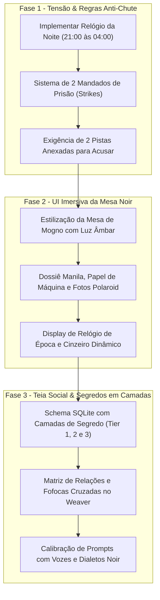

# Relatório de Pesquisa & Game Design v2: Anti-Brute Force, Mesa Noir Imersiva e Teia Social de Personagens
**Autor:** Oracle (Game Researcher & Ideator)  
**Data:** 14 de Outubro de 2026  
**Projeto:** Detetive IA — Refinamento de Game Design & Experiência Imersiva  
**Referência:** Feedback do Criador após Testes da v0.2 (`docs/RESEARCH_FEEDBACK_V2.md`)

---

## 1. Diagnóstico dos Feedbacks do Criador

O feedback da v0.2 tocou nos três pontos fundamentais que separam um jogo casual esquecível de uma obra-prima de dedução investigativa:
1. **Falta de Tensão / Chute Infinito:** Sem punição por erro ou limite de tempo, o jogador é incentivado a testar combinações até acertar (brute force), eliminando a sensação de conquista intelectual (*Eureka!*).
2. **Interface Genérica:** O visual atual em cartões web padronizados quebra a atmosfera sombria dos anos 40. Falta tato, textura e a sensação de estar em uma delegacia esfumaçada da era do jazz.
3. **Personagens Superficiais:** Personagens sem relacionamentos mútuos e sem segredos em camadas soam como NPCs de papelão. Um grande mistério precisa de drama interpessoal, chantagem e falsas pistas orgânicas.

---

## 2. Pesquisa de Referências e Soluções na Indústria de Jogos

### 2.1. Como os Clássicos Combatem o "Brute Force"
* **Ace Attorney (*Gyakuten Saiban*):** O juiz impõe penalidades diretas por objeções e apresentações de provas descabidas (medidor de paciência do tribunal / 5 strikes). Ao zerar, o réu é considerado culpado sumariamente.
* **Return of the Obra Dinn:** Lucas Pope impede a dedução por tentativa e erro ao validar palpites **exclusivamente em blocos de 3 destinos corretos simultâneos**. Um chute isolado não recebe confirmação nem rejeição.
* **The Case of the Golden Idol:** As sentenças da dedução exigem o preenchimento de palavras-chave recolhidas no cenário. O jogo apenas avisa se restam "menos de 2 erros", impedindo triangulação estatística fácil.
* **Shadows of Doubt & Sherlock Holmes Consulting Detective:** O tempo é uma moeda finita. Cada endereço visitado ou testemunha interrogada consome minutos valiosos de um relógio in-game.

### 2.2. A Estética da "Mesa Diegética" (Diegetic Desk Interface)
* **Papers, Please:** Toda a interface de controle de passaportes é uma escrivaninha de madeira com carimbos, regras datilografadas e gaveta de subornos. O jogador manuseia documentos físicos na tela.
* **Strange Horticulture & Cultist Simulator:** O tabuleiro de jogo *é* a mesa de estudo, com cartas antigas, fotos desgastadas, plantas e lupas sobre feltro e madeira escura.
* **L.A. Noire & The Wolf Among Us:** Dossiês encadernados em papel kraft manila, recortes de jornal da época com tipografia serifada, anotações à mão e fumaça de cigarro densa recortada pela luz de persianas venezianas.

### 2.3. A Teia Social e Segredos em Camadas (Layered Secrets & Social Graph)
* **Blood on the Clocktower & Clue/Detetive:** O mistério se sustenta porque inocentes também têm segredos condenáveis (desvios de dinheiro, casos extraconjugais, pequenos furtos). Quando acuados, inocentes mentem para esconder seus próprios deslizes, gerando *Red Herrings* legítimos que o detetive precisa destrinchar.
* **Pentiment & Disco Elysium:** NPCs têm vozes distintas, dialetos marcados, vícios evidentes e opiniões ferinas uns sobre os outros. Uma pergunta sobre o Suspeito A feita ao Suspeito B revela ódio, inveja ou cumplicidade velada.

---

## 3. Propostas Estruturadas de Mecânicas para o Detetive IA

---

### PILAR A: Mecânicas de Tensão, Tempo e Fim de Partida (Anti-Brute Force)

#### 1. O Relógio da Madrugada (Action Economy / The Night Clock)
* **Conceito:** O crime ocorreu às **21:00**. O trem de fuga do assassino parte às **04:00 da madrugada**. O detetive tem exatamente **7 horas fictícias** (420 minutos) para resolver o caso.
* **Custo das Ações do Jogador:**
  - Fazer uma pergunta no interrogatório: **+15 minutos**.
  - Confrontar suspeito com uma evidência: **+20 minutos**.
  - Explorar uma nova cena de crime / cômodo: **+30 minutos**.
  - Solicitar perícia aprofundada: **+45 minutos**.
* **Condição de Derrota por Tempo:** Se o relógio atingir 04:00 antes da emissão do mandado correto:  
  *Game Over: "O Expresso Noturno partiu da estação central. O assassino escapou para sempre nas sombras da cidade."*

#### 2. Mandados de Prisão Limitados (Chief's Patience / 2 Strikes)
* **Conceito:** O detetive não tem carta branca do Chefe de Polícia e do Juiz de Plantão. Ele possui apenas **2 Mandados de Prisão**.
* **Falha 1 (1º Erro):** O Chefe de Polícia emite uma advertência furiosa:  
  *"Detetive, você acabou de prender um inocente! A imprensa está cobrando a minha cabeça. Se você errar de novo, seu distintivo vai direto para a minha gaveta!"*
* **Falha 2 (2º Erro):**  
  *Game Over: "Distintivo Cassado. Você foi afastado da corporação por negligência e o caso foi arquivado sem solução."*

#### 3. Requisito de Evidência Corroborativa (Evidence-Gated Accusation)
* **Conceito:** Para acusar, não basta selecionar o Suspeito, a Arma e o Motivo. O jogador é obrigado a anexar **2 Pistas Coletadas** que fundamentem a acusação.
* **Validação:** Se o jogador anexar pistas irrelevantes que não se conectam ao suspeito no grafo lógico, o Juiz recusa a assinatura do mandado por "Falta de Provas Materiais", consumindo **30 minutos** do relógio da madrugada.

* **Prós:**
  - Aniquila completamente o brute force e o chute aleatório.
  - Transforma cada clique em uma decisão tensa e calculada.
  - Dá significado dramático e satisfação real à vitória.
* **Contras:**
  - Jogadores excessivamente precipitados podem perder rapidamente (mitigado com mensagens claras de tutorial no início).
* **Viabilidade Técnica em Go + SQLite:** **10/10**. Requer apenas duas colunas na tabela `investigations` (`time_spent_minutes`, `warrants_remaining`) e checagem de regras no endpoint `/api/game/accuse`.

---

### PILAR B: UI Cinematográfica Noir Imersiva (Diegetic Desk Interface)

#### 1. A Mesa de Investigação dos Anos 1940 (CSS Puro & Texturas Leves)
* **Superfície da Escrivaninha:**
  - Fundo em tom mogno escuro envelhecido (`#14110f`) com textura sutil de couro e feltro.
  - Iluminação direcional: cone de luz âmbar/dourado (`radial-gradient`) simulando uma luminária de mesa articulada focada nos documentos centrais.
  - Efeito suave de sombras de persianas venezianas com animação lenta de fumaça de tabaco no topo da tela.

#### 2. Elementos Táteis Skeuomórficos
* **O Dossiê do Caso (Manila Folder):**
  - O relatório inicial é apresentado como uma pasta parda/kraft (`#cfba9b`) com abas superiores, clipes de papel metálicos e um carimbo vermelho inclinado em 15º com a inscrição `CONFIDENCIAL` ou `CASO Nº 409-B`.
* **Fotos Periciais com Alfinete Vermelho:**
  - Os retratos dos suspeitos ganham moldura Polaroid/P&B com borda inferior larga, leve rotação angular (`transform: rotate(-2deg)` a `rotate(3deg)`) e um alfinete de cabeça vermelha (`pushpin`) fixando a foto no topo da folha.
* **Relatório em Papel de Máquina de Escrever:**
  - Pautas sutis, tipografia monoespaçada mecânica (`Special Elite` ou `Courier Prime`), fitas pretas e cursor piscante.
* **Relógio Analógico Art Déco:**
  - No canto superior da mesa, um mostrador clássico de relógio de estação/bolso marcando o ponteiro das horas avançando a cada ação realizada (`21:00 -> 04:00`).
* **Cinzeiro & Fagulhas (Efeito Atmosférico):**
  - Cinzeiro com cigarro e fio de fumaça subindo através de animação CSS leve (`@keyframes smoke`), transmitindo a atmosfera de cansaço e tensão da noite chuvosa.

* **Prós:**
  - Converte o jogo de uma "tabela de formulários web" em uma experiência cinematográfica memorável.
  - 100% implementável em CSS3 moderno e SVG nativo, com **zero impacto no orçamento de 30MB RAM** do servidor e do cliente PWA.
* **Contras:**
  - Requer refatoração cuidadosa dos estilos em `web/static/css/style.css` e templates HTML.
* **Viabilidade Técnica:** **10/10**.

---

### PILAR C: Teia Social e Segredos em Camadas dos Personagens

#### 1. O Modelo do "Drama em Três Camadas" (The Three-Tier Secret System)
Cada personagem gerado pelo motor procedural recebe 3 camadas de revelação:

| Camada | Nível de Estresse | O que o Personagem Revela | Reação Visual / Narrativa |
| :---: | :---: | :--- | :--- |
| **Camada 1: Fachada Pública** | 0% - 30% | Álibi formal polido. O assassino mente com firmeza; os inocentes escondem pequenos detalhes para não se envolver. | Olhar calmo, postura desdenhosa, respostas curtas e evasivas. |
| **Camada 2: O Delito Secundário** | 31% - 70% | Ao ser confrontado com uma contradição leve, o suspeito entra em pânico e **confessa um crime menor que NÃO é o assassinato** (ex: roubou joias da mansão, estava em um encontro clandestino, falsificou notas promissórias). | Gotas de suor, engole a seco, voz trêmula. Revela pistas sobre o comportamento de *outros* suspeitos. |
| **Camada 3: A Quebra do Álibi / Confissão** | 71% - 100% | Confrontado com a prova forense irrefutável (a arma ou vestígio material), a farsa se desfaz por completo. | Ruptura dramática: o culpado se desespera ou tenta justificar o crime com raiva cega. |

#### 2. Teia de Relações Intercruzadas (The Social Web)
Ao gerar a partida, o `Weaver` constrói uma matriz de relações:
* **Vítima $\leftrightarrow$ Suspeitos:** Dívidas, testamentos contestados, amantes e disputas de herança.
* **Suspeito A $\leftrightarrow$ Suspeito B:** Alianças frágeis, chantagens mútuas e fofocas venenosas.  
  *Exemplo:* O Mordomo sabe que a Femme Fatale deve dinheiro a agiotas no cais; a Femme Fatale sabe que o Magnata comprou veneno para ratos há três dias.
* **Efeito no Jogo:** O jogador descobre as fraquezas de um suspeito interrogando outros, incentivando a exploração cruzada de depoimentos.

#### 3. Personalidades & Cadências de Fala Únicas
Injeção de diretrizes de voz no prompt de cada arquétipo:
* **A Femme Fatale:** Frases lânguidas, ironia afiada, tratamento condescendente ("detetive, querido"), dissimulação sofisticada.
* **O Magnata Industrial:** Tom autoritário, ameaças de influência política, ultraje de ser tratado como suspeito ("Você sabe com quem está falando?").
* **O Vigarista / Jogador Noturno:** Gírias do submundo, pressa, nervosismo, desconfiança paranoica de todos.
* **O Guarda-Livros / Mordomo:** Formalidade gélida, vocabulário rebuscado, observação clínica dos detalhes da casa.

* **Prós:**
  - Torna cada conversa fascinante; o jogador quer interrogar todos para desvendar as intrigas da mansão.
  - Gera os momentos clássicos de romance policial onde todos parecem culpados de algo.
* **Contras:**
  - Requer prompts de contexto mais ricos no backend e expansão das colunas de personas no SQLite.
* **Viabilidade Técnica em Go + SQLite:** **Alta (9/10)**.

---

## 4. Plano de Priorização & Roadmap de Execução (Sprint v0.3)

### Prioridade 1: Imediato (Anti-Brute Force e Economia de Ações)
1. Adicionar colunas `time_remaining_minutes` (420 min) e `warrants_remaining` (2) na tabela `investigations`.
2. Consumir tempo a cada pergunta, confronto ou exploração e bloquear acusação sem 2 pistas selecionadas.
3. Exibir tela de Game Over personalizada para tempo esgotado ou mandados esgotados.

### Prioridade 2: Mesa Noir Imersiva (Visual Refactor)
1. Substituir os cartões planos padrão por elementos estilizados: Dossiê Kraft, fotos Polaroid com pin vermelho e tipografia datilografada.
2. Adicionar o mostrador do relógio analógico na barra superior da mesa.

### Prioridade 3: Segredos em Camadas no Weaver
1. Modelar as 3 camadas de segredos no gerador de casos procedural (`internal/game/weaver.go`).
2. Implementar confissão de delitos secundários quando o estresse atingir a faixa de 30% a 70%.

---

## 5. Conclusão

Com essas três melhorias, o **Detetive IA** resolverá integralmente os pontos de atrito identificados pelo criador:
- O **chute infinito** é substituído por **tensão genuína com consequências reais**.
- A **interface genérica** se torna uma **mesa de detetive dos anos 40 altamente atmosférica e tátil**.
- Os **personagens planos** ganham **vidas secretas, dramas cruzados e revelações progressivas**.

*Relatório pronto para validação pelo Orquestrador Antigravity e posterior implementação pela equipe.*
