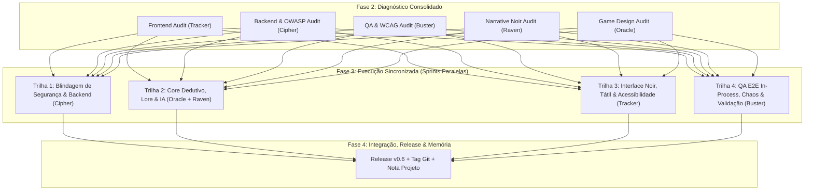

# Plano de Ação Unificado — Revisão Geral do Projeto Detiv (v0.6)
**Documento de Consolidação da Fase 2**  
**Orquestrador:** Antigravity (Maestro)  
**Equipe:** Tracker (Frontend), Cipher (Backend), Buster (QA), Raven (Narrativa), Oracle (Game Design)  
**Data:** 17 de Outubro de 2026  
**Status:** Consolidado e Pronto para Execução Sincronizada (Fase 3)

---

## 🎯 Visão Geral da Release v0.6

A revisão diagnóstica paralela da Fase 1 colheu cinco relatórios técnicos exaustivos em `docs/reviews/`. Este plano unificado compila e organiza as correções e evoluções em **4 Trilhas de Execução Sincronizadas**, garantindo que o projeto atinja o mais alto patamar de segurança de produção, profundidade lúdica, refinamento cinematográfico Film Noir e conformidade total de acessibilidade e testes.

---

## 🛠️ Trilha 1: Blindagem de Segurança, Infraestrutura & Backend (Cipher)

### Objetivos:
Eliminar vulnerabilidades críticas OWASP (A01, A03, A04, A05, A07), blindar rotas administrativas, garantir concorrência segura e manter consumo de memória < 30MB.

| ID | Ação Técnica | Arquivo / Linha | Impacto |
| :--- | :--- | :--- | :--- |
| **SEC-01** | Remover chave de API hardcoded do schema inicial de migração e carregar estritamente via variáveis de ambiente / input administrativo autenticado. | `internal/db/schema.go:127` | Blindagem de credenciais (CWE-798) |
| **SEC-02** | Exterminar backdoor estático `X-Admin-Key` e query param `?key=`. Exigir sessão autenticada com role `admin` para todas as rotas `/api/admin/*`. | `internal/server/handlers.go:828, 1028` | Prevenção de bypass de autenticação (CWE-284) |
| **SEC-03** | Proteger endpoints administrativos abertos: `/api/admin/logs`, `/api/admin/telemetry`, `POST /api/admin/test-ai` e mascarar 100% da `api_key` em `GET /api/admin/settings`. | `internal/server/handlers.go:855, 912, 928, 940` | Proteção contra DoS e vazamento de tokens |
| **SEC-04** | Adicionar headers HTTP de segurança defensivos (`Content-Security-Policy`, `X-Content-Type-Options: nosniff`, `X-Frame-Options: DENY`, `Strict-Transport-Security`) e restringir CORS. | `internal/server/server.go:93-104` | Proteção contra XSS, Clickjacking e CSRF |
| **SEC-05** | Corrigir condição de corrida (Data Race) em `UniversalAIClient` adicionando `sync.RWMutex` em leitura e atualização de credenciais. | `internal/game/ai_interrogator.go:56-65` | Concorrência thread-safe |
| **SEC-06** | Corrigir colisão de convidados não-autenticados em salas (`userID = 2`), gerando IDs efêmeros únicos baseados em sessão ou timestamp atômico. | `internal/server/handlers.go:700-705` | Isolamento de sessões no multiplayer |

---

## 📜 Trilha 2: Core Dedutivo, Lore & IA (Oracle + Raven)

### Objetivos:
Restaurar o mistério e o momento "Eureka" do jogador, eliminar spoilers prematuros nas pistas, conferir coerência aos 4 temas e modular a IA sob estresse.

| ID | Ação Técnica | Arquivo / Linha | Impacto |
| :--- | :--- | :--- | :--- |
| **DED-01** | **Remover Spoiler nas Pistas:** Reescrever geração de pistas no `Weaver` para nunca citar o nome literal do assassino nas pistas 2 e 3. A pista de álibi deve apontar contradições materiais/horárias e a pista documental deve exigir dedução do proprietário. | `internal/game/weaver.go:450-462` | Restauração da Regra das Três Pistas e dedução |
| **DED-02** | **Validação Semântica de Evidências:** Atualizar `SubmitAccusation` para receber `ClueIDs` e validar se ao menos uma das pistas anexadas realmente corrobora o meio (arma) ou o motivo do culpado. | `internal/game/game.go:297`, `internal/server/handlers.go:527` | Fim do formalismo vazio nas acusações |
| **LORE-01** | **Preservar Segredos dos Inocentes:** Eliminar o laço que sobrescreve o `Tier3Truth` de todos os bots inocentes com uma frase genérica. Preservar suas biografias individuais ricas. | `internal/game/weaver.go:380-384` | Profundidade dramática e red herrings |
| **LORE-02** | **Dinâmica da Vítima por Tema:** Substituir o nome hardcoded "Arthur" nos arquétipos pelo nome dinâmico da vítima do cenário (`theme.VictimShort`), com álibis coerentes com o espaço físico (trem, ópera, cassino, mansão). | `internal/game/weaver.go:64-112, 185-250` | Fim dos anacronismos de cenário |
| **AI-01** | **Integração Real de Estresse no Confronto:** Conectar o confronto de pistas (`confront_clue_id`) à chamada de IA com prompt de estresse elevado, eliminando respostas estáticas pré-fabricadas. | `internal/server/handlers.go:411-455` | Diálogos dinâmicos reativos com a IA |
| **AI-02** | **Limpeza do Fallback Offline:** Remover checagens legadas de "Julian" e "Elena" e ancorar o prompt noir 1940s com delimitação segura contra injeções. | `internal/game/ai_interrogator.go:132-170`, `internal/game/game.go:266` | Estilo literário hardboiled autêntico |

---

## 🎨 Trilha 3: Interface Noir, Ergonomia & Acessibilidade (Tracker)

### Objetivos:
Eliminar AI Slop, aplicar benchmarks modernos (Inspora, Spell.sh, Refero Design, shadcn/ui), resolver WCAG 2.1 AA e criar o layout ergonômico de 2 colunas no interrogatório.

| ID | Ação Técnica | Arquivo / Linha | Impacto |
| :--- | :--- | :--- | :--- |
| **UI-01** | **Purga de AI Slop & Nova Paleta:** Substituir variáveis padrão do Tailwind `:root` e inline de `admin.html` pela paleta Film Noir (âmbar de tungstênio `#e09f3e`, papel kraft `#c2a679`, fuligem `#121214`, linho envelhecido `#e9e4d8`). | `web/static/css/style.css:5-25`, `web/templates/admin.html` | Identidade visual cinematográfica autêntica |
| **UI-02** | **Interrogatório em 2 Colunas (Refero):** Redesenhar o modal de interrogatório no desktop: Coluna Esquerda com Palco do Suspeito, Holofote e Polígrafo analógico; Coluna Direita com Dossiê de transcrições e barra de input ancorada na base (*sticky*). | `web/templates/index.html:369-436`, `web/static/css/style.css` | Ergonomia sem rolagem exaustiva em laptops |
| **UI-03** | **Física Tátil (Spell.sh):** Implementar compressão elástica em botões e fichas (`:active { transform: scale(0.97); }` / `active:scale-[0.98]`). | `web/static/css/style.css` | Sensação tátil de alta fidelidade |
| **UI-04** | **Substituição de Emojis por SVGs Monocromáticos:** Trocar emojis multicoloridos contemporâneos por ícones limpos em latão/marfim, preservando a imersão de época. | `web/templates/index.html` | Coerência estética Film Noir |
| **UI-05** | **Polígrafo Analógico:** Transformar a barra plana de estresse em uma agulha oscilante com traçado eletrocardiográfico responsivo. | `web/static/css/style.css`, `web/static/js/app.js` | Tensão visual dramática no interrogatório |
| **AUDIO-01** | **Compressor de Áudio & Soundscape:** Injetar `DynamicsCompressorNode` na cadeia de áudio do `audio.js` e adicionar camadas de som ambiente (chuva e tique-taque ritmado). | `web/static/js/audio.js` | Áudio diegético imersivo sem clipping |

---

## 🧪 Trilha 4: QA, Testes In-Process, Chaos & Acessibilidade (Buster)

### Objetivos:
Garantir que `go test ./...` passe 100% verde em qualquer máquina sem dependência de servidor pré-iniciado, e elevar a acessibilidade para conformidade estrita WCAG 2.1 AA.

| ID | Ação Técnica | Arquivo / Linha | Impacto |
| :--- | :--- | :--- | :--- |
| **TEST-01** | **Servidor In-Process no Chaos Test:** Refatorar `tests/chaos/chaos_test.go` para usar `httptest.NewServer` como fallback automático quando `http://localhost:8080` não responder. `go test ./...` passará 100% verde sem intervenção manual. | `tests/chaos/chaos_test.go:40-50` | CI/CD determinista e testes autônomos |
| **WCAG-01** | **Desbloqueio de Zoom Mobile:** Remover `maximum-scale=1.0, user-scalable=no` da meta tag viewport. | `web/templates/index.html:5` | Conformidade WCAG 1.4.4 |
| **WCAG-02** | **Semântica Interativa:** Substituir `
` com click por botões semânticos `<button>` nas abas de login, cartões de armas do mandado e abas de administração. | `web/templates/index.html:63`, `web/templates/admin.html:57` | Navegabilidade por teclado e leitores de tela |
| **WCAG-03** | **Anéis de Foco Visível (`:focus-visible`):** Adicionar regras `:focus-visible` universais com anel âmbar contrastante de 2px e deslocamento de 2px. | `web/static/css/style.css` | Conformidade WCAG 2.4.7 |
| **WCAG-04** | **Touch Targets Mínimos (44x44px):** Expandir botões `#sound-toggle`, `.modal-close` e chips para área mínima de 44x44px. | `web/static/css/style.css` | Ergonomia móvel WCAG 2.5.5 / 2.5.8 |
| **WCAG-05** | **Regiões Vivas (`aria-live`):** Inserir `aria-live="polite"` no Relógio da Madrugada, contador de mandados e transcrição do interrogatório. | `web/templates/index.html:34, 41, 409` | Notificação a tecnologias assistivas |
| **WCAG-06** | **Rótulos ARIA:** Adicionar `aria-label` descritivos nos botões de fechar modal (`&times;`), lupa e botões de atalho. | `web/templates/index.html:374, 443, 473` | Acessibilidade para leitores de tela |

---

## 📅 Roteiro de Execução da Fase 3

1. **Sprint 3A: Núcleo & Testes Verdes** (Cipher & Buster)
   - Resolução do `chaos_test.go` in-process (`go test ./...` 100% PASS).
   - Eliminação de vulnerabilidades críticas OWASP (chaves hardcoded, backdoor estático, headers de segurança).
2. **Sprint 3B: Game Design & Narrativa** (Oracle & Raven)
   - Remoção de spoilers nas pistas do `weaver.go`.
   - Preservação do Tier 3 nos inocentes e correções de anacronismo dos cenários.
   - Validação semântica de pistas em `SubmitAccusation`.
3. **Sprint 3C: Frontend Noir, Acessibilidade & Áudio** (Tracker & Buster)
   - Aplicação da paleta Film Noir (remoção do AI slop).
   - Redesenho do interrogatório em 2 colunas com polígrafo e física tátil.
   - Aplicação de todas as diretrizes WCAG 2.1 AA (touch targets, `:focus-visible`, `aria-live`).
4. **Sprint 3D: Validação Final, Smoke Test & Release v0.6** (Maestro & Equipe)
   - Execução de `go test ./...` completo.
   - Smoke test no portal `http://localhost:8080`.
   - Atualização da nota `Projeto`, documentação de lições aprendidas e publicação da tag `v0.6`.
