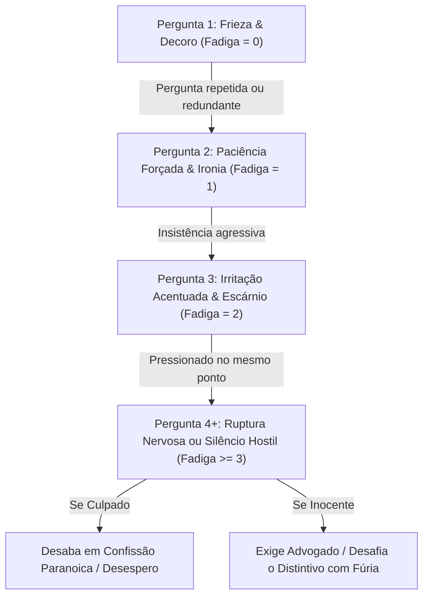

# Especificação Narrativa & Arquitetura de Personagens Expandidos
**Autor:** Raven (Narrative-Noir-Writer)  
**Data:** 17 de Outubro de 2026  
**Projeto:** Detetive-IA (Detiv) — Versão Expandida v0.6  
**Status:** Proposta Estruturada para Implementação  

---

## 1. Visão Geral & Filosofia Literária

Em um clássico policial dos anos 1940 (Dashiell Hammett, Raymond Chandler, Cornell Woolrich), um suspeito nunca é uma folha em branco com um álibi de uma linha. Um verdadeiro suspeito noir tem:
1. **Passado e Ofício:** Uma profissão histórica com termos, ferramentas, cheiros e vícios específicos da época.
2. **Rotina e Itinerário Forense:** Um dia a dia documentado minuto a minuto no dia do crime, onde cada hora esconde encontros clandestinos, recibos amarrotados e testemunhos cruzados.
3. **Maneirismos e Tiques Nervosos Táteis:** O corpo fala antes da boca — o estalo de um isqueiro Zippo, o ajuste de um colarinho engomado sufocante, o tremor imperceptível ao segurar uma xícara de porcelana.
4. **Fadiga de Interrogatório:** Ninguém responde à mesma pergunta dez vezes da mesma forma. O interrogatório é uma guerra psicológica de atrito: começa em frieza aristocrática ou indiferença das docas, passa pelo sarcasmo e irritação, e culmina em explosão dramática ou exaustão paranoica.
5. **Cofre de Personagens Salvos:** Dossiês manila reutilizáveis que jogadores e mestres de jogo podem cadastrar, personalizar e convocar em qualquer partida.

---

## 2. Catálogo de Arquétipos & Ocupações Históricas dos Anos 1940

Abaixo, 8 arquétipos históricos completos divididos pelos cenários do jogo:

### 2.1. Mansão do Vale das Sombras

#### Arquétipo 1: O Guarda-Livros e Curador Privado
- **Nome Sugerido:** Barnaby Finch (ou customizável)
- **Ocupação Histórica:** *Guarda-livros Chefe & Curador de Coleções Raras*
- **Aparência & Atmosfera:** Terno de três peças cinza-chumbo, mangas presas por elásticos de alfaiate, dedos permanentemente manchados de tinta ferrogálica azul-escura, óculos redondos de aro de tartaruga.
- **Voz & Tom:** Monótona, subserviente na superfície, gélida e venenosa nas entrelinhas. Vocabulário formal e arcaico.
- **Tiques Nervosos & Maneirismos:**
  - Ajusta os óculos pelo centro da ponte com o dedo indicador rígido sempre que é encurralado.
  - Alisa compulsivamente o livro-razão ou tamborila as unhas na madeira imitando o ritmo de uma pena escrevendo.
  - Pigarreia seco e rasposo antes de contestar uma acusação direta.

#### Arquétipo 2: A Médica Patologista e Toxicologista
- **Nome Sugerido:** Dra. Nicole Moreau
- **Ocupação Histórica:** *Médica Patologista e Ex-Cirurgiã da Cruz Vermelha*
- **Aparência & Atmosfera:** Jaleco de linho engomado sobre vestido sóbrio de lã, cheiro persistente de éter, fenol e fumo barato de cigarro sem filtro. Cabelo preso em coque severo com mechas prateadas.
- **Voz & Tom:** Cirúrgica, desprovida de sentimentalismo, cínica perante a morte e a hipocrisia da alta sociedade.
- **Tiques Nervosos & Maneirismos:**
  - Bate as pontas de dois cigarros Gauloises contra a caixinha de prata antes de acender um deles.
  - Examina as próprias unhas limpas com olhar microscópico quando o detetive faz conjecturas ignorantes.
  - Sorri com um canto da boca em desdém ao ouvir teorias leigas sobre venenos ou hemorragias.

---

### 2.2. Expresso da Meia-Noite

#### Arquétipo 3: O Criptógrafo e Adido Consular
- **Nome Sugerido:** Viktor / Alexei Vane
- **Ocupação Histórica:** *Criptógrafo Diplomático & Mensageiro da Mala Diplomática*
- **Aparência & Atmosfera:** Sobretudo pesado de gabardine com dragonas militares despidas de insígnias, pasta de couro presa ao pulso por corrente de latão cromado, olhos com olheiras profundas de insônia.
- **Voz & Tom:** Sussurrada, calculista, cheia de pausas estratégicas. Mede cada sílaba como se pudesse desencadear uma crise diplomática internacional.
- **Tiques Nervosos & Maneirismos:**
  - Gira a chave da algema da mala diplomática em volta do polegar.
  - Checa reflexos nos vidros da janela do vagão à procura de perseguidores nas estações.
  - Molha os lábios ressecados com conhaque e morde o lábio inferior quando confrontado com telegramas interceptados.

#### Arquétipo 4: A Correspondente Fotográfica de Guerra
- **Nome Sugerido:** Evelyn "Flash" Sterling
- **Ocupação Histórica:** *Fotojornalista Internacional da Associated Press*
- **Aparência & Atmosfera:** Calças de montaria de sarja marrom, casaco de couro de aviador puído nos cotovelos, câmera Speed Graphic a tiracolo, cheiro de fixador químico e tabaco Virginia.
- **Voz & Tom:** Rápida, mordaz, destemida, com sotaque cosmopolita e vocabulário cortante de redação de jornal.
- **Tiques Nervosos & Maneirismos:**
  - Aciona o obturador da câmera vazia como mecanismo antiestresse (um *clique* metálico seco no meio da conversa).
  - Guarda negativos protegidos em papel manteiga no bolso interno do casaco a cada 5 minutos.
  - Dá risadas roucas quando o detetive tenta intimidá-la com autoridade policial.

---

### 2.3. Teatro de Ópera Municipal

#### Arquétipo 5: O Cenógrafo e Iluminador de Arco de Carvão
- **Nome Sugerido:** Ignácio Rossi
- **Ocupação Histórica:** *Mestre de Maquinaria Teatral e Iluminação Cênica*
- **Aparência & Atmosfera:** Camisa de algodão cru com marcas de fuligem, calos espessos nas palmas das mãos, suspensórios pesados, chave inglesa de boca e rolo de corda de cânhamo na cintura.
- **Voz & Tom:** Rouca, dramática, habituada a berrar por cima do som da orquestra e dos rangidos de polias.
- **Tiques Nervosos & Maneirismos:**
  - Esfrega a fuligem dos dedos na calça enquanto evita encarar a cena do crime.
  - Testa o peso e o nó das cordas próximas, puxando-as com violência nervosa.
  - Olha obsessivamente para os balcões superiores e para o teto, como se esperasse que um refletor despencasse.

#### Arquétipo 6: A Mezzo-Soprano e Diva Lírica
- **Nome Sugerido:** Clarice Dubois (ou Madame Carmem)
- **Ocupação Histórica:** *Segunda Cantora da Companhia Lírica & Herdeira de Dívidas de Jogo*
- **Aparência & Atmosfera:** Echarpe de raposa prateada sobre vestido de veludo carmesim, pó de arroz perfumado com jasmim oriental, lábios pintados com carmim escuro, luvas de cetim até os cotovelos.
- **Voz & Tom:** Aveludada, melodramática, alternando entre sedução refinada e acessos histéricos de desprezo quando ameaçada.
- **Tiques Nervosos & Maneirismos:**
  - Pressiona o lenço de renda umedecido contra o decote para estancar o suor frio.
  - Bebe pequenos goles de licor de cereja direto de uma garrafinha de bolso banhada a prata.
  - Desvia os olhos para o espelho do camarim e ajeita cachos postiços com dedos trêmulos.

---

### 2.4. Cassino Clandestino & Submundo das Docas

#### Arquétipo 7: O Chefe de Mesa de Bacará
- **Nome Sugerido:** Emilio / Hector "Duas-Caras" Silva
- **Ocupação Histórica:** *Croupier Profissional & Operador de Banca Clandestina*
- **Aparência & Atmosfera:** Smoking impecável com gravata borboleta preta levemente torta, unhas polidas, anel de rubi sintético no mindinho, olhar rápido de predador acostumado a detectar cartas marcadas.
- **Voz & Tom:** Macia, impassível, polida como um espelho de cassino. Nunca levanta a voz até que as apostas fujam do controle.
- **Tiques Nervosos & Maneirismos:**
  - Embaralha um baralho invisível entre os dedos com destreza hipnótica.
  - Passa a ponta da língua nos dentes da frente ao ouvir o nome do chefe da polícia ou do agiota.
  - Limpa a superfície da mesa de feltro verde com a palma da mão, tirando poeira imaginária.

#### Arquétipo 8: O Boxeador Aposentado e Cobrador de Dívidas
- **Nome Sugerido:** "Trovão" Jack Callahan
- **Ocupação Histórica:** *Ex-Campeão de Peso Médio & Segurança de Casa de Jogos*
- **Aparência & Atmosfera:** Nariz quebrado duas vezes, cicatriz no supercílio esquerdo, ombros maciços que esticam um terno listrado barato, chapéu fedora amassado sobre a testa.
- **Voz & Tom:** Grave, gutural, monossilábica. Fala com o canto da boca como quem masca tabaco e cuspiu dentes no tablado.
- **Tiques Nervosos & Maneirismos:**
  - Estala os nós dos dedos das mãos alternadamente com sons secos e ameaçadores.
  - Massageia a mandíbula com a palma da mão fechada como se ainda sentisse um golpe de 1938.
  - Cerra os punhos sob a mesa até as juntas ficarem brancas quando é confrontado com seu passado militar.

---

## 3. Sistema de Rotinas & Linha do Tempo Forense (The Crime Timeline)

Cada suspeito agora possui um itinerário completo do dia do crime estruturado em 6 marcos temporais canônicos da Madrugada Noir:

```
[18h00: Crepúsculo] ──→ [20h30: Banquete / Abertura] ──→ [22h00: Incidente Prévio]
                              │
[04h00: Cerco Policial] ←── [02h15: O Grito / Descoberta] ←── [00h45: HORA FATÍDICA DO CRIME]
```

### Exemplo de Rotina Integrada: Dra. Nicole Moreau
1. **18h00 (Preparação):** Estava no dispensário da clínica pública preparando frascos de morfina sob receitas da alta sociedade (cruzamento com seu Tier 2).
2. **20h30 (Chegada ao Local):** Chegou à mansão/trem/ópera de táxi sob chuva torrencial. Cruzou com Barnaby na entrada de serviço.
3. **22h00 (Discussão Testemunhada):** Teve uma conversa áspera a portas fechadas com a vítima sobre o livro de receitas ilegais. Hector Vance ouviu vozes alteradas.
4. **00h45 (Hora do Crime — Álibi vs. Realidade):**
   - *Álibi Declarado (Tier 1):* "Estava no laboratório temporário trancada esterilizando agulhas e laudos."
   - *Itinerário Real:* Desceu até o corredor dos fundos para recuperar o livro de receitas no cofre da vítima; viu uma sombra encapuzada fugindo pela janela do jardim de inverno.
5. **02h15 (Descoberta):** Chamada às pressas para atestar o óbito da vítima. Fingiu surpresa e declarou parada cardíaca inicial para encobrir a substância letal.
6. **04h00 (Interrogatório):** Retida na sala fria, cinzeiro cheio e pronta para blefar.

---

## 4. Dinâmica de Reações a Perguntas Repetidas (Pacing & Escalada de Estresse)

O interrogador mantém um contador de insistência por suspeito e tópico (`repeat_count`). Em vez de dar sempre a mesma resposta robótica, o personagem reage através da **Curva de Fadiga Psicológica Noir**:



### Matriz de Transições de Diálogo por Fadiga:

| Nível de Fadiga | Estado Psicológico | Reação Típica do Suspeito | Exemplo Diegético |
|---|---|---|---|
| **0 (Normal)** | Composto, Frio, Cínico | Responde formalmente mantendo o álibi (Tier 1). | *"Como já expliquei, inspetor, eu estava na biblioteca lendo os relatórios contábeis."* |
| **1 (Alerta)** | Impaciente, Levemente Teso | Destaca que já respondeu, usa ironia ou maneirismo. | *(Ajusta os óculos com força)* *"Minha resposta não mudou nos últimos dez minutos, cavalheiro. Eu estava na biblioteca. Deseja que eu descreva a encadernação dos livros?"* |
| **2 (Hostil)** | Irritado, Desdenhoso | Confronta o intelecto ou a autoridade do detetive. | *(Bate o cinzeiro na mesa)* *"O senhor é pago por pergunta repetida ou sua memória sofreu um desfalque? Já disse onde estava e com quem estava!"* |
| **3+ (Ruptura)** | Desesperado ou Paranoico | Pede advogado, berra ou entrega segredo menor para desviar. | *(Grita com a voz rouca e olhos arregalados)* *"Chega desse teatrinho! Se tem uma acusação formal, ponha as algemas e chame o promotor! Você não tem nada contra mim além de fumaça e palpites!"* |

---

## 5. Schema do "Cofre de Personagens Salvos" (Saved Dossiers)

Para permitir que o jogador e o mestre salvem personagens favoritos em um arquivo/banco persistente, o seguinte schema JSON será suportado na API e no SQLite:

```json
{
  "dossier_id": "char_nicole_moreau_1942",
  "name": "Dra. Nicole Moreau",
  "alias": "A Doutora de Gelo",
  "age": 39,
  "gender": "female",
  "occupation": "Médica Patologista & Toxicologista",
  "social_class": "Alta Burguesia Decadente",
  "historical_era": "1940s Film Noir",
  "avatar_preset": "/static/assets/char_nicole.webp",
  "personality": {
    "traits": ["Metódica", "Cínica", "Impassível", "Fumante Inveterada"],
    "voice_tone": "Gélido, cirúrgico, frases cortadas e irônicas",
    "mannerisms": [
      "Bater as pontas de cigarros na caixa de prata antes de acender",
      "Examinar as próprias unhas com desdém perante teorias leigas",
      "Pressionar os nós dos dedos contra as têmporas ao ouvir gritos"
    ]
  },
  "timeline_routine": {
    "18h00": "Dispensário da clínica pública preparando frascos confidenciais.",
    "20h30": "Chegada sob tempestade; entrega de laudo no gabinete da vítima.",
    "22h00": "Discussão acalorada a portas fechadas sobre o livro de receitas ilícitas.",
    "00h45": "Tentativa de recuperar o livro no cofre; avistou vulto no corredor.",
    "02h15": "Chamada para examinar o cadáver; declaração proposital de causa incerta.",
    "04h00": "Retida na sala de interrogatório, cinzeiro transbordando."
  },
  "secrets_hierarchy": {
    "tier1_alibi": "Afirma que passou a madrugada esterilizando instrumentos no laboratório temporário.",
    "tier2_petty_crime": "Prescrevia morfina sob nomes falsos para sustentar dívidas de jogo do irmão.",
    "tier3_truth": "Encontrou a vítima ainda respirando e negou socorro por vingança pessoal."
  },
  "cross_suspicions": [
    {
      "target_role": "Mordomo",
      "suspicion_text": "Notei resíduos de pó branco sob as luvas de serviço de Barnaby quando ele recolheu as taças."
    },
    {
      "target_role": "Jornalista",
      "suspicion_text": "Vincent rondava a janela dos fundos como uma hiena faminta por desgraça alheia."
    }
  ]
}
```

---

## 6. Próximos Passos de Integração no Código (Fase 2)

1. **Campos no SQLite (`internal/db/schema.go`):**
   - Adicionar colunas `timeline_json`, `mannerisms_json` e `fatigue_counter` na tabela `suspects`.
   - Criar tabela `saved_dossiers` com suporte a CRUD via `/api/admin/dossiers` ou perfil de jogador.
2. **Atualização do Prompt no `game.go`:**
   - Injetar os maneirismos, rotina de horários e a reação de fadiga diretamente na diretriz do LLM.
3. **Frontend Diegético (`web/static/js/app.js`):**
   - Exibir os tiques nervosos como micro-descrições em itálico entre colchetes acima do balão de fala:  
     *`[Nicole bate a ponta do cigarro na caixinha de prata e solta uma baforada densa]`*
   - Indicador visual sutil no palco de interrogatório quando a fadiga do suspeito subir para níveis perigosos.
